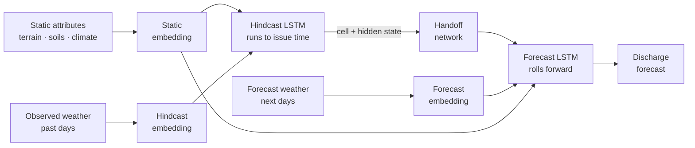
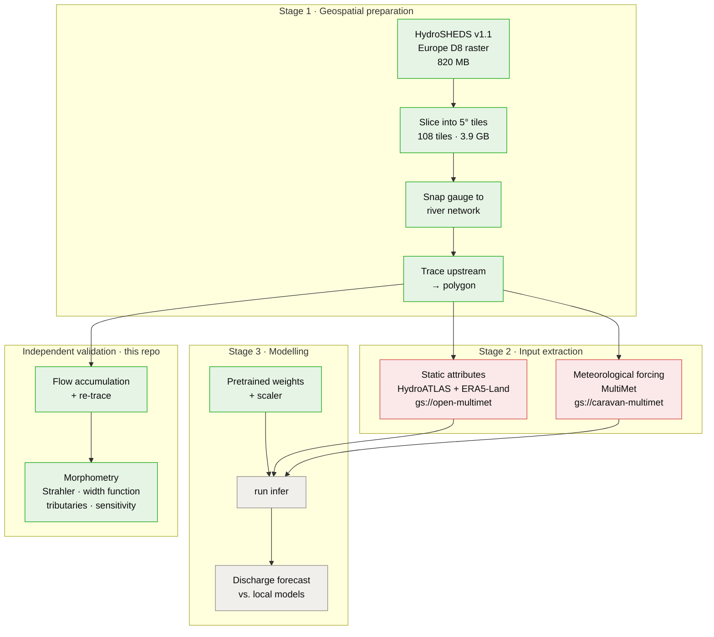
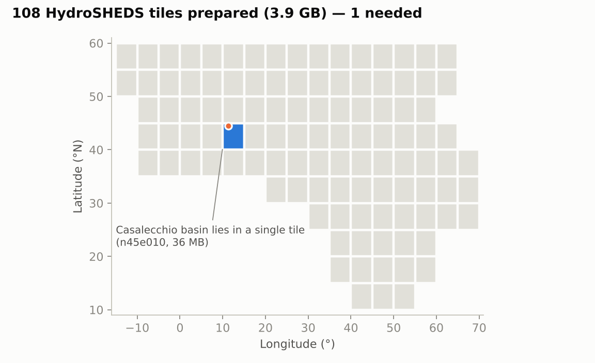
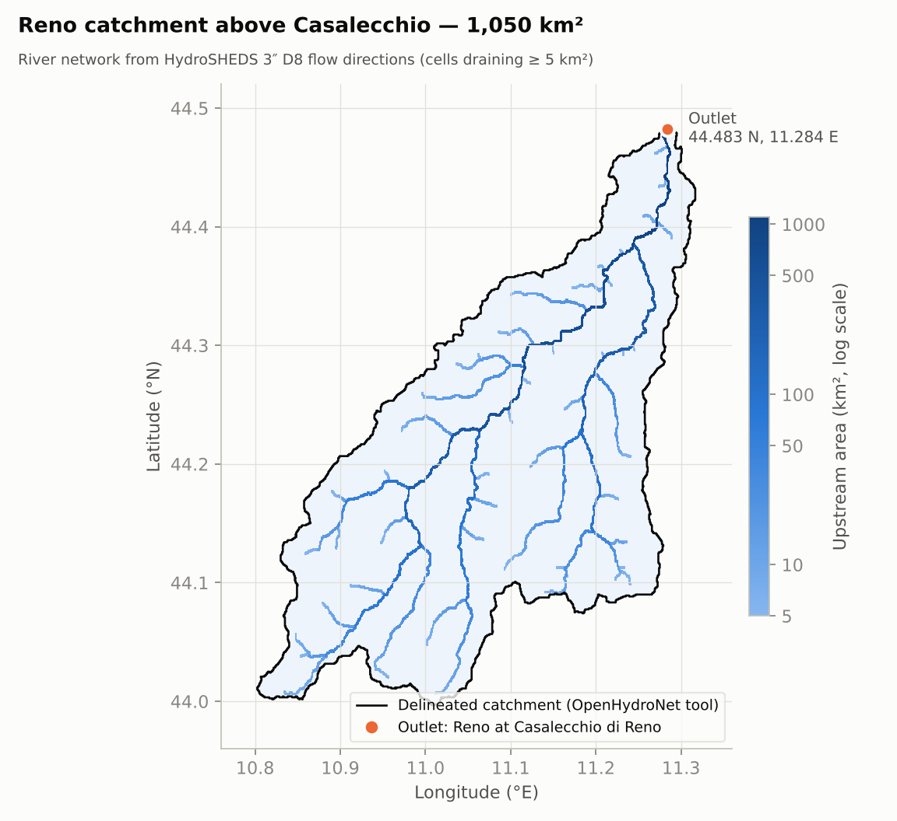
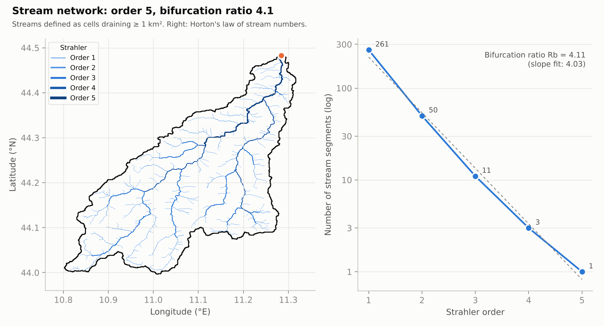
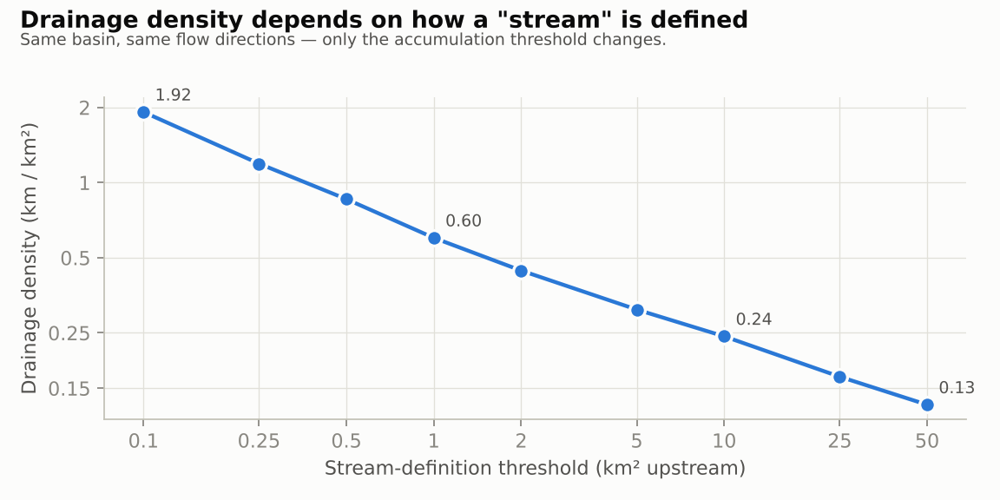
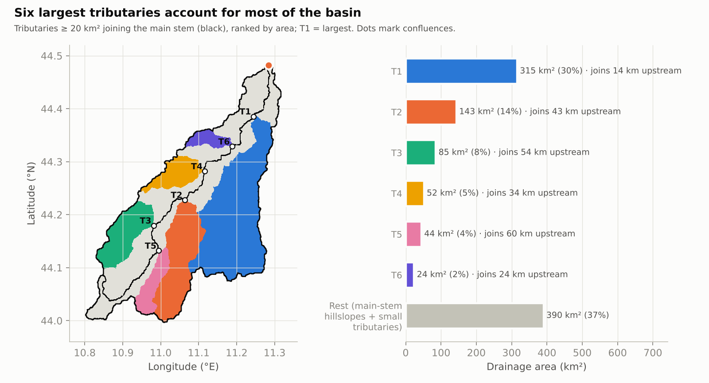
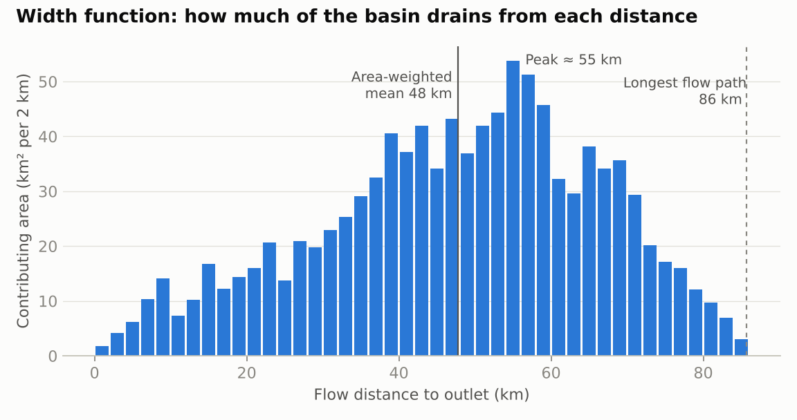
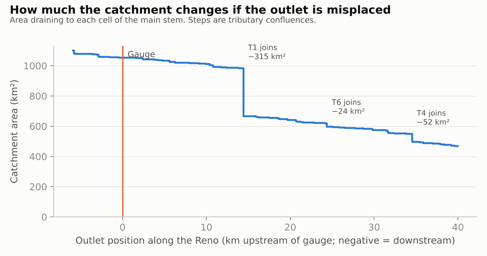

# OpenHydroNet Baseline Feasibility — Reno at Casalecchio

-orange.svg)

**Can a researcher outside Google run Google's open-source flood-forecasting model, OpenHydroNet, on a new Italian river?**

This repository tests that end to end for the **Reno river at Casalecchio di Reno** (Bologna, Italy). It reports what worked, what didn't, and what the catchment analysis reveals about the basin.

> This repository does **not** contain OpenHydroNet's code. It contains my setup script, an independent analysis script, results, figures and notes. OpenHydroNet ([`google-research/flood-forecasting`](https://github.com/google-research/flood-forecasting)) belongs to Google Research and is licensed under Apache 2.0.

---

## Key Findings

| # | Finding | Evidence |
|---|---|---|
| 1 | **Catchment delineation works and is accurate.** OpenHydroNet's tool delineates 1,050.1 km²; the geodesic area of the same polygon is 1,055.9 km²; the reference is 1,053 km². | [Results 1](#1-delineation-and-validation) |
| 2 | **The delineation is independently reproducible.** A from-scratch re-trace on the raw flow directions selects the same cells (IoU = 0.9998). | [Results 1](#1-delineation-and-validation) |
| 3 | **The tool's reported area is ~0.55 % low** because it converts degrees to km with a rounded 111.0 km/°. The boundary is right; only the area arithmetic is off. | [Discussion](#area-conventions-matter-at-the-sub-percent-level) |
| 4 | **The basin is elongated and tributary-dominated.** Order-5 network, bifurcation ratio 4.1. The largest tributary (30 % of the area) joins only 14 km above the gauge. | [Results 3–5](#3-stream-network) |
| 5 | **Gauge placement is safe locally, risky near confluences.** ±2 km along the Reno changes the area by < 0.6 %; placing the outlet just above the T1 confluence would lose 37 %. | [Results 7](#7-outlet-sensitivity) |
| 6 | **Inference was blocked by data access, not by the model.** The static attributes and forcing are served from Google Cloud buckets that refused all outside accounts. | [Results 9](#9-data-access) |

---

## Table of Contents

- [Introduction](#introduction)
- [Background: OpenHydroNet](#background-openhydronet)
- [Study Area](#study-area)
- [Pipeline](#pipeline)
- [Method](#method)
- [Results](#results)
- [Discussion](#discussion)
- [Conclusion](#conclusion)
- [Getting Started](#getting-started)
- [Project Structure](#project-structure)
- [Future Work](#future-work)
- [Credits and Licensing](#credits-and-licensing)
- [References](#references)
- [Author](#author)

---

## Introduction

### Motivation

Operational flood forecasting traditionally relies on models calibrated river by river. Nearing et al. (2024) showed that a **single LSTM trained on thousands of basins worldwide** can forecast extreme floods in ungauged basins, with reliability at five-day lead times comparable to or better than the GloFAS global system at nowcast. Google has since open-sourced these models as **OpenHydroNet**.

For anyone building a basin-specific model, this creates an obvious baseline question: *does my local model beat the global one?* If not, the local training adds nothing.

### Research question

> Using only public resources, can OpenHydroNet's published pipeline be applied to a new gauge, the Reno at Casalecchio, to produce forecasts that could serve as a baseline?

### What this repository contributes

| Contribution | Where |
|---|---|
| A reproducible Windows setup for OpenHydroNet with pip (the upstream assumes conda) | `setup_env.bat`, `ENVIRONMENT.md` |
| A delineated, validated catchment polygon for the Reno at Casalecchio | `data/casalecchio/casalecchio_425.geojson` |
| An independent re-implementation of the catchment analysis (accumulation, Strahler order, width function, tributaries, outlet sensitivity) | `scripts/make_figures.py` |
| Basin morphometrics in machine-readable form | `results/catchment_metrics.json` |
| A documented account of where and why the public pipeline breaks for new basins | [Results 9](#9-data-access), [Discussion](#open-weights-are-not-an-open-pipeline) |

---

## Background: OpenHydroNet

### The models

OpenHydroNet is a heavily extended fork of [NeuralHydrology](https://github.com/neuralhydrology/neuralhydrology) (Kratzert et al., 2022). It ships two forecasting architectures. Both split time at the **issue time** of the forecast: a *hindcast* period with observed weather, and a *forecast* period with predicted weather.

| Model | How it works | Status in Google Flood Hub |
|---|---|---|
| **Mean-Embedding-Forecast-LSTM** | Separate embedding networks for hindcast and forecast inputs. Inputs from several weather products are aggregated with a **masked mean**, so missing products are tolerated, then fed to a hindcast LSTM and a forecast LSTM (Gauch et al., 2025). | Current production model |
| **Handoff-Forecast-LSTM** | A hindcast LSTM runs up to the issue time. Its cell and hidden states pass through a **handoff network** that initialises a forecast LSTM (Nearing et al., 2024). | Former production model |
| **Data assimilation** (optional) | At inference, latent embeddings are adjusted by gradient descent so the output matches recent observed discharge. Weights are not changed. | Supported for Mean-Embedding only |

The Handoff-Forecast-LSTM, as documented upstream:

### What a new basin needs

The model is trained once, globally. To use it on a new basin, you must give it the **same inputs, in the same form**, as the training basins:

| Input | What it is | Source in OpenHydroNet | Public? |
|---|---|---|---|
| Catchment polygon | All land draining to the gauge | Derived locally from HydroSHEDS | ✅ |
| Static attributes | Basin descriptors (terrain, soils, land cover) from HydroATLAS, plus climate indices computed from ERA5-Land | `gs://open-multimet` | ⛔ |
| Meteorological forcing | Daily weather series for the basin (MultiMet) | `gs://caravan-multimet/v1.1` | ⛔ |
| Weights + scaler | Trained network and input normalisation | GitHub | ✅ |

The scaler matters: inputs must be normalised exactly as in training. Approximate or substitute attributes would put the basin outside the distribution the model learned.

---

## Study Area

The **Reno** is the main river of the Bologna area. Its upper basin lies in the Tuscan–Emilian Apennines. At **Casalecchio di Reno**, just south-west of Bologna, the river leaves the hills and enters the Po plain. That makes Casalecchio the natural closing section for the mountain catchment.

| Property | Value | Source |
|---|---|---|
| Gauge coordinates | 44.4825 N, 11.2842 E | Input |
| Catchment area | 1,050–1,056 km² | This study (see Results 1) |
| Longest flow path | 85.7 km | This study |
| Main stem length (to source) | 84.2 km | This study |
| Max. Strahler order | 5 | This study (1 km² threshold) |

---

## Pipeline

The full OpenHydroNet pipeline for a new gauge has three stages. This project completed the first and added an independent validation branch.

Green = done · red = blocked · grey = not reached.

| # | Step | Tool | Status |
|---|---|---|---|
| 1 | Clone repo, create venv, install dependencies | `setup_env.bat` | ✅ Done (upstream commit `0112654`) |
| 2 | Download HydroSHEDS Europe D8 raster | manual | ✅ Done (820 MB) |
| 3 | Slice raster into 5° × 5° tiles | `scripts/slice_continental_dems.py` | ✅ Done (108 tiles) |
| 4 | Delineate catchment | `delineate-catchment` | ✅ Done (1,050.1 km²) |
| 5 | Independent validation and morphometry | `scripts/make_figures.py` (this repo) | ✅ Done |
| 6 | Extract static attributes | `extract-caravan-static` | ⛔ Blocked |
| 7 | Fetch meteorological forcing | `gs://caravan-multimet/v1.1` | ⛔ Blocked |
| 8 | Inference with pretrained weights | `run infer` | ⏸ Not reached |

---

## Method

### 1. Flow directions (D8)

The D8 model assumes water leaves each grid cell towards exactly **one** of its eight neighbours: the steepest downhill one. HydroSHEDS (Lehner et al., 2008) provides this as a grid at **3 arc-seconds**, which is about 93 m north–south × 66 m east–west at 44 °N. Each cell holds a code:

| Code | 1 | 2 | 4 | 8 | 16 | 32 | 64 | 128 |
|---|---|---|---|---|---|---|---|---|
| Flows to | E | SE | S | SW | W | NW | N | NE |

The codes link every cell to one downstream cell, so the whole landscape becomes a **forest of trees** whose roots are river mouths. Every hydrological quantity below is a traversal of that tree.

### 2. Tiling

OpenHydroNet slices the continental raster into 5° × 5° NumPy tiles of 6000 × 6000 cells (36 MB each), keyed by their top-left corner. Delineation then loads only the tiles a basin touches.

### 3. Snapping the gauge

Gauge coordinates rarely fall exactly on the modelled channel. A 90 m offset can put the point on a hillslope that drains a few hectares instead of the river. OpenHydroNet's delineator therefore **snaps** the gauge to the best channel cell within a 12-cell window. Optionally, it also searches for a cell whose upstream area matches an *expected area*.

My independent re-trace uses the simplest rule: the cell with the highest flow accumulation in a 5 × 5 window around the gauge. It uses **no area hint**, so agreement with the tool cannot come from tuning to the reference area.

### 4. Upstream trace

From the snapped outlet, every cell whose D8 path reaches it is collected. OpenHydroNet does this with a breadth-first search across tile boundaries, then polygonises the cell set.

### 5. Area computation

Three area estimates are compared, because they use different conventions:

| Estimate | How | Note |
|---|---|---|
| Tool | Cell count × (Δ° × 111.0 km)² × cos φ | Flat constant of 111.0 km per degree |
| Re-trace | Exact cell area on the authalic sphere (R = 6371.007 km) | Sphere of equal surface area to WGS84 |
| Geodesic | Polygon area on the WGS84 ellipsoid (`pyproj.Geod`) | Reference-quality |

### 6. Independent catchment analysis

`scripts/make_figures.py` re-implements everything from the raw tile, without importing OpenHydroNet:

| Analysis | Method |
|---|---|
| **Flow accumulation** | Topological sort of the D8 tree (Kahn's algorithm, sources first), then summing cell areas downstream. |
| **Flow distance** | Reverse traversal from the outlet, adding each cell's step length (orthogonal or diagonal, latitude-corrected). |
| **Width function** | Histogram of catchment area by flow distance to the outlet, in 2 km bins. |
| **Stream network** | Cells draining ≥ 1 km². |
| **Strahler order** | Sources are order 1. When two streams of equal order *u* meet, the result is *u* + 1; otherwise the higher order continues. |
| **Main stem** | From the outlet, repeatedly step to the upstream neighbour with the largest accumulation. |
| **Tributaries** | Every non-main-stem neighbour of the main stem draining ≥ 20 km²; the six largest are mapped. |
| **Outlet sensitivity** | Upstream area at every main-stem cell from 6 km downstream to 40 km upstream of the gauge. |

### 7. Morphometric indices

| Index | Formula | Meaning |
|---|---|---|
| Gravelius compactness $K_c$ | $P / (2\sqrt{\pi A})$ | 1 = circle; higher = more irregular |
| Circularity $R_c$ | $4\pi A / P^2$ | 1 = circle |
| Elongation $R_e$ | $2\sqrt{A/\pi} / L_b$ | ~1 = round; < 0.7 = elongated |
| Form factor $R_f$ | $A / L_b^2$ | Low = elongated, flatter hydrograph |
| Drainage density $D_d$ | $\sum L_{\text{streams}} / A$ | Channel length per unit area |
| Bifurcation ratio $R_b$ | mean of $N_u / N_{u+1}$ | Typically 3–5 in natural basins |

$A$ = area, $P$ = perimeter, $L_b$ = basin length (straight-line distance from the outlet to the farthest basin cell), $N_u$ = number of stream segments of order $u$.

---

## Results

All numbers are in [`results/catchment_metrics.json`](results/catchment_metrics.json) and can be regenerated with `python scripts/make_figures.py`.

### 1. Delineation and validation

| Quantity | Value |
|---|---|
| Area — OpenHydroNet tool | **1,050.1 km²** |
| Area — geodesic (WGS84) of the tool's polygon | **1,055.9 km²** |
| Area — independent re-trace (authalic sphere) | 1,054.0 km² |
| Reference area | 1,053 km² |
| Tool vs. reference | −0.28 % |
| Geodesic vs. reference | +0.28 % |
| **Re-trace vs. tool polygon (IoU)** | **0.9998** |
| Cells in catchment | 171,232 |

### 2. Basin shape

| Index | Value | Interpretation |
|---|---|---|
| Area (geodesic) | 1,055.9 km² | — |
| Perimeter (geodesic, raster outline) | 241.5 km | Inflated by the cell "staircase" edge |
| Basin length $L_b$ | 65.4 km | — |
| Longest flow path | 85.7 km | — |
| Area-weighted mean flow distance | 47.8 km | — |
| Elongation ratio $R_e$ | **0.56** | Elongated |
| Form factor $R_f$ | **0.25** | Elongated |
| Circularity $R_c$ | 0.23 | Low (partly due to raster perimeter) |
| Gravelius $K_c$ | 2.10 | High (partly due to raster perimeter) |

### 3. Stream network

| Strahler order | 1 | 2 | 3 | 4 | 5 |
|---|---|---|---|---|---|
| Segments | 261 | 50 | 11 | 3 | 1 |
| Total length (km) | 286.7 | 156.1 | 99.3 | 56.7 | 34.5 |

| Network metric | Value |
|---|---|
| Bifurcation ratio $R_b$ | **4.11** (log-linear fit: 4.03) |
| Drainage density (1 km² threshold) | 0.60 km/km² |
| Total stream length | 633 km |

Stream numbers follow Horton's law almost perfectly: the points sit on a straight line in log scale.

### 4. Drainage density depends on the threshold

Drainage density falls from **1.92** to **0.13 km/km²** as the stream threshold rises from 0.1 to 50 km². It is not a property of the basin alone; it is a property of the basin **and** the stream definition.

### 5. Tributary structure

| ID | Area (km²) | Share | Joins main stem at | Distance upstream of gauge |
|---|---|---|---|---|
| T1 | 315.4 | 30 % | 44.385 N, 11.244 E | 14.3 km |
| T2 | 143.4 | 14 % | 44.228 N, 11.063 E | 43.1 km |
| T3 | 85.1 | 8 % | 44.180 N, 10.981 E | 53.6 km |
| T4 | 51.6 | 5 % | 44.282 N, 11.116 E | 34.4 km |
| T5 | 44.5 | 4 % | 44.132 N, 10.995 E | 59.8 km |
| T6 | 23.6 | 2 % | 44.329 N, 11.188 E | 24.3 km |
| Rest | ~390 | 37 % | main-stem hillslopes + tributaries < 20 km² | — |

T1's confluence lies at Sasso Marconi, where the **Setta** joins the Reno, so T1 is most likely the Setta.

### 6. Width function

Only **3.5 %** of the basin lies within 10 km (flow distance) of the outlet, while **65 %** lies between 35 and 70 km upstream. The area-weighted mean flow distance is 48 km and the peak is at ~55 km.

### 7. Outlet sensitivity

| Outlet position along the Reno | Area (km²) | Change vs. gauge |
|---|---|---|
| 2 km downstream | 1,059.4 | +0.5 % |
| 1 km downstream | 1,055.5 | +0.1 % |
| **Gauge** | **1,054.0** | — |
| 1 km upstream | 1,053.0 | −0.1 % |
| 2 km upstream | 1,051.4 | −0.2 % |
| 5 km upstream | 1,034.6 | −1.8 % |
| 14 km upstream (just below T1) | 982.4 | −6.8 % |
| 15 km upstream (just above T1) | 666.0 | **−36.8 %** |

### 8. Data volume

| Item | Size | Needed for this basin |
|---|---|---|
| HydroSHEDS Europe D8 raster | 820 MB | Yes (source) |
| 5° tiles | 3.9 GB (108 tiles) | 1 tile (36 MB) |
| Catchment polygon | 160 KB | Output |

### 9. Data access

| Request | Result |
|---|---|
| Pretrained weights and scaler (GitHub) | ✅ Downloaded |
| HydroSHEDS raster (public download) | ✅ Downloaded |
| `gs://open-multimet` (HydroATLAS mirror, ERA5-Land climate indices) | ⛔ Access denied, including for authenticated accounts |
| `gs://caravan-multimet/v1.1` (MultiMet forcing) | ⛔ Not reached; depends on the same access |
| Public precomputed source for the four `*_ERA5_LAND` attributes | ⛔ None found |

---

## Discussion

### The delineation can be trusted

Three independent lines of evidence agree:

- the tool's polygon
- a from-scratch re-trace that shares no code with the tool (IoU 0.9998)
- the reference area (within ±0.3 %)

The re-trace used no expected-area hint, so the match is not circular. For the purpose of feeding OpenHydroNet, the polygon is ready.

### Area conventions matter at the sub-percent level

The tool reports 1,050.1 km², but the geodesic area of its own polygon is 1,055.9 km². The difference (−0.55 %) comes from the constant `_KM_PER_DEGREE = 111.0` in the delineator. The true length of a degree of latitude near 44 °N is ~111.1 km, and the authalic-sphere value is ~111.2 km. Squared, a 0.2–0.3 % error in that constant becomes a ~0.5 % error in area.

This is small, but it is systematic. Every basin delineated with the tool is under-reported by roughly the same fraction. It matters whenever area is used to convert discharge into runoff depth (mm/day), which is a common way to train and evaluate basin-scale models.

The reference value (1,053 km²) sits between the two estimates. Without knowing how the reference itself was computed, neither estimate can be called more correct.

### What the basin's shape says about floods

The morphometry describes a **long, narrow, tributary-fed mountain basin**:

- **Elongation** ($R_e$ = 0.56, $R_f$ = 0.25). Elongated basins tend to produce lower, longer flood peaks than compact basins of the same area, because water from the far end arrives later than water from near the outlet.
- **Width function peaked far upstream** (~55 km). Two-thirds of the basin lies 35–70 km from the outlet along the river network, so rain over the middle and upper Apennines matters more for the flood peak at Casalecchio than rain near Bologna.
- **One dominant tributary close to the gauge.** T1 (most likely the Setta) drains 30 % of the basin and joins only 14 km upstream. Its flood wave can arrive at a different time from the main-stem wave. The worst case is the two coinciding.

For a forecasting model, these points have practical consequences. The model needs **basin-wide** forcing, with good coverage of the upper Apennines. A model that only sees rainfall near the outlet will miss most of the signal. This is also why OpenHydroNet averages forcing over the whole polygon.

### Gauge placement and why snapping matters

The sensitivity curve shows two regimes:

- **Along a reach between confluences, the area is stable.** Moving the outlet ±2 km changes the area by < 0.6 %, so ordinary coordinate errors (tens to hundreds of metres) are harmless here.
- **At confluences, the area jumps.** An outlet placed 1 km too far upstream at Sasso Marconi would lose the T1 tributary and 37 % of the basin.

This justifies OpenHydroNet's optional expected-area snapping: near confluences, coordinates alone are not enough, and a known area acts as a sanity check.

### Open weights are not an open pipeline

The model weights, code and documentation are public. The inputs that make the weights usable for a new basin are not:

- The **static attributes** must match the training distribution exactly, including four ERA5-Land climate indices. They are only precomputed in a bucket outside users cannot read.
- **Recomputing** them means downloading ~40 years of hourly ERA5-Land data from Copernicus. That is possible, but it takes hours to days and needs care to reproduce Google's exact processing.
- **Substituting** approximate attributes would feed the network inputs it was not trained on. Any skill (or lack of it) would then reflect the substitution, not the model.

The practical conclusion: OpenHydroNet is currently **reproducible for basins already in Google's prepared datasets** and **hard to extend to new basins** from outside Google. For a fair baseline, the input pipeline needs as much attention as the model.

### Limitations

| Limitation | Effect |
|---|---|
| HydroSHEDS 3″ is a global, conditioned product | Small streams and karst or artificial drainage (canals, reservoirs) may be misrepresented. A national DEM would be a useful cross-check. |
| No elevation data used | Slope, relief and hypsometric analysis are not included. |
| Raster perimeter | The staircase outline inflates $P$, so $K_c$ and $R_c$ overstate irregularity. Elongation and form factor don't use $P$ and are more reliable. |
| Stream threshold is a choice | Drainage density and Strahler counts depend on it (Results 4). 1 km² is used for comparability, not because it is "true". |
| Tributary naming | T1 is identified by its confluence location. The other tributaries are reported by coordinates only. |
| Reference area of unknown origin | The 0.3 % agreement should be read with this in mind. |
| No discharge data used | This study characterises the basin. It does not evaluate any forecast. |

---

## Conclusion

The geospatial half of OpenHydroNet's pipeline works for the Reno at Casalecchio. The catchment is delineated to within 0.3 % of the reference and confirmed by an independent re-implementation. The catchment analysis shows an elongated, order-5 basin whose flood response is dominated by the middle and upper Apennines and by one large tributary joining 14 km above the gauge.

The modelling half could not be reached. The model's required inputs are hosted in buckets that outside users cannot access, and they cannot be cheaply recomputed. Using OpenHydroNet as a baseline for a new basin therefore requires rebuilding its input pipeline from public data first.

---

## Getting Started

**Requirements:** Windows, Git, Python on `PATH`, about 5 GB of free disk space.

| Step | Action |
|---|---|
| 1 | Clone this repository |
| 2 | Run `setup_env.bat` from the repo root. It clones `google-research/flood-forecasting` into `flood-forecasting/`, creates `.venv` and installs dependencies. |
| 3 | Download the HydroSHEDS v1.1 Europe & Middle East 3″ DIR layer to `data/raw_hydrosheds/` |
| 4 | Slice and delineate as described in [`ENVIRONMENT.md`](ENVIRONMENT.md) |
| 5 | `pip install -r requirements.txt`, then `python scripts/make_figures.py` to reproduce all figures and `results/catchment_metrics.json` |

`pip install -e .` on the upstream repo installs **no** dependencies (`install_requires=[]`, because it expects conda). `setup_env.bat` installs the full list from `environments/conda.yml` with pip instead.

---

## Project Structure

| Path | Description | In this repo |
|---|---|---|
| `setup_env.bat` | One-shot environment setup for Windows | ✅ |
| `env_lock.txt` | `pip freeze` from the first setup run | ✅ |
| `requirements.txt` | Dependencies for the analysis script | ✅ |
| `ENVIRONMENT.md` | Step-by-step setup log and technical notes | ✅ |
| `scripts/make_figures.py` | Independent catchment analysis and all figures | ✅ |
| `results/catchment_metrics.json` | All computed metrics | ✅ |
| `figures/` | PNGs used in this README | ✅ |
| `data/casalecchio/casalecchio_425.geojson` | Delineated catchment polygon | ✅ |
| `flood-forecasting/` | Upstream clone, created by `setup_env.bat` | ❌ git-ignored |
| `data/raw_hydrosheds/` | HydroSHEDS raster (820 MB) | ❌ git-ignored |
| `data/tiles_5deg/` | Sliced D8 tiles (3.9 GB) | ❌ git-ignored |

---

## Future Work

- [ ] Compute the four `*_ERA5_LAND` climate attributes from Copernicus CDS, following Caravan's published processing
- [ ] Rebuild the HydroATLAS static attributes from the public HydroATLAS release
- [ ] Assemble daily forcing from ERA5-Land and run `run infer` with the pretrained weights
- [ ] Fine-tune only the static embedding layer, as suggested in the upstream tutorial for outlier basins
- [ ] Compare against basin-specific models at the same gauge (NSE, KGE, peak timing)
- [ ] Cross-check the delineation with a national high-resolution DEM and add elevation-based metrics

---

## Credits and Licensing

| Component | Owner | License |
|---|---|---|
| OpenHydroNet / `googlehydrology` (not included) | Google Research | Apache 2.0 |
| NeuralHydrology (upstream of OpenHydroNet) | NeuralHydrology developers | BSD-3-Clause |
| HydroSHEDS flow-direction data (used to derive the GeoJSON) | WWF / HydroSHEDS | HydroSHEDS License |
| Setup script, analysis script, notes, results | Farhad Bayrami | MIT (see [`LICENSE`](LICENSE)) |

This is an independent project. It is not affiliated with or endorsed by Google.

---

## References

1. Nearing, G. et al. (2024). *Global prediction of extreme floods in ungauged watersheds.* Nature. https://www.nature.com/articles/s41586-024-07145-1
2. Gauch, M. et al. (2025). *How to deal with missing input data.* Hydrology and Earth System Sciences, 29, 6221. https://hess.copernicus.org/articles/29/6221/2025/
3. Kratzert, F. et al. (2022). *NeuralHydrology — A Python library for Deep Learning research in hydrology.* Journal of Open Source Software, 7(71), 4050.
4. Lehner, B., Verdin, K., Jarvis, A. (2008). *New global hydrography derived from spaceborne elevation data.* Eos, 89(10), 93–94.
5. Strahler, A. N. (1957). *Quantitative analysis of watershed geomorphology.* Transactions, American Geophysical Union, 38(6), 913–920.
6. Horton, R. E. (1945). *Erosional development of streams and their drainage basins.* Geological Society of America Bulletin, 56(3), 275–370.
7. Rodríguez-Iturbe, I., Valdés, J. B. (1979). *The geomorphologic structure of hydrologic response.* Water Resources Research, 15(6), 1409–1420.
8. Google Research — flood-forecasting repository: https://github.com/google-research/flood-forecasting

---

## Author

**Farhad Bayrami** — ML Engineer, MSc in Artificial Intelligence (University of Bologna)

[GitHub](https://github.com/FarhadBayrami) · [ORCID](https://orcid.org/0009-0001-5786-3363)
